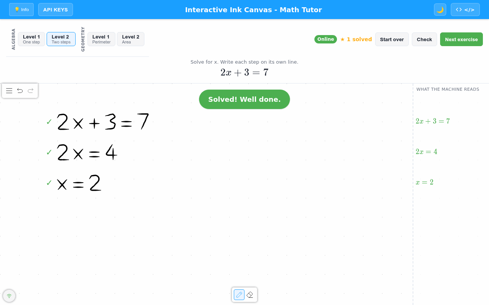
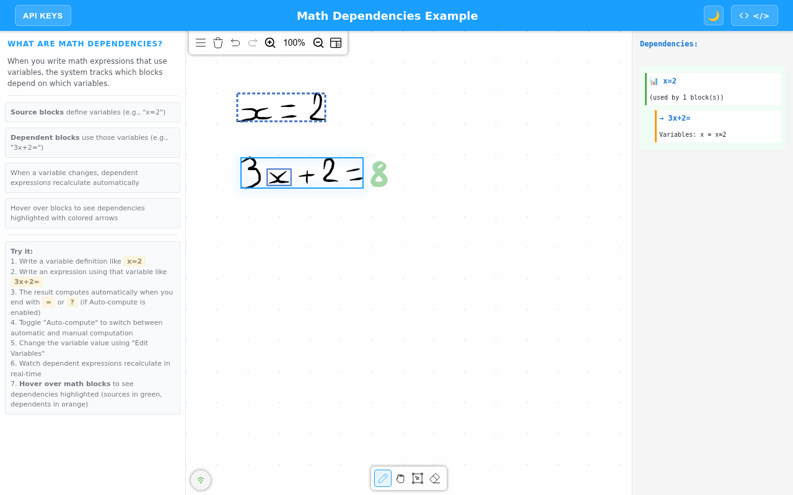
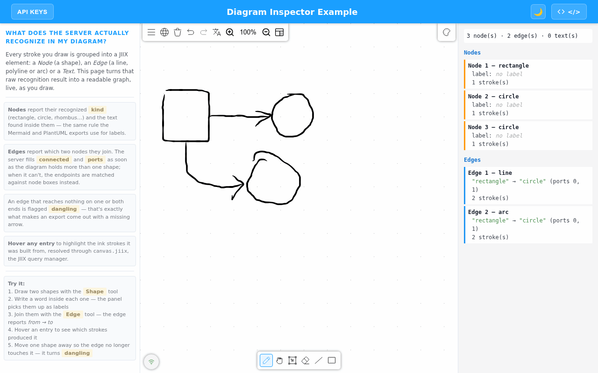
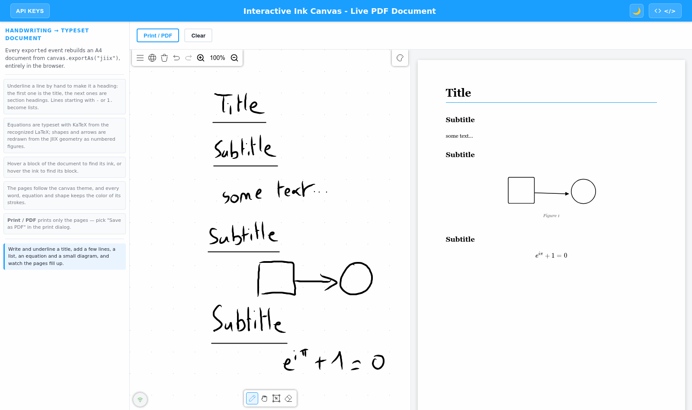
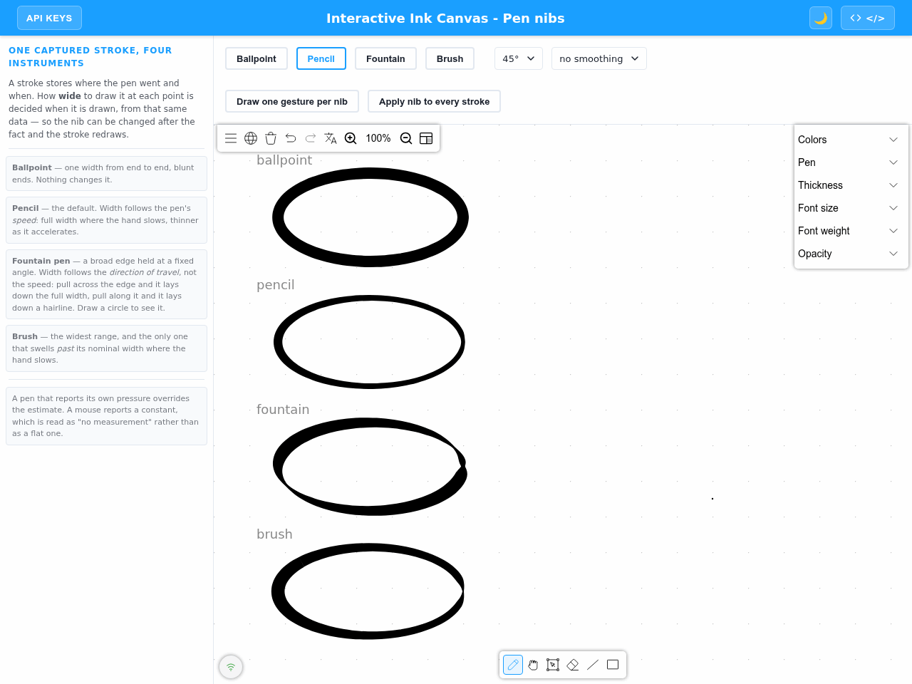
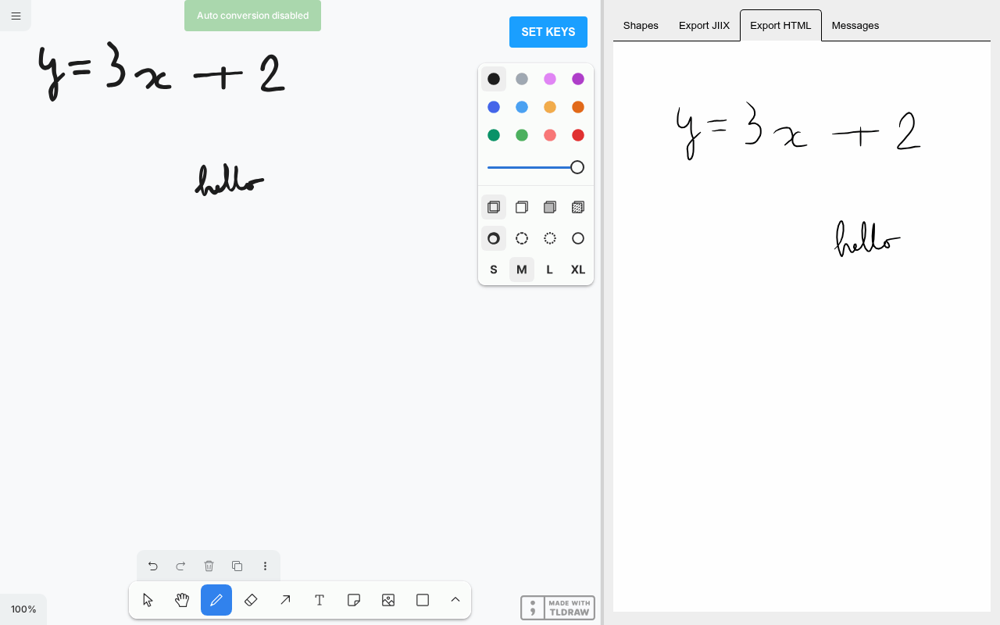

# iinkTS

[](https://badge.fury.io/js/iink-ts)
[](https://myscript.github.io/iinkTS/examples/)
[](https://developer.myscript.com/docs/interactive-ink/latest/web/iinkts/)

> The fastest way to integrate rich **handwriting** features in your webapp.
>
> :point_right: [Examples](https://myscript.github.io/iinkTS/examples/):point_left:

<div align="center">
  
</div>

iinkTS is a TypeScript library that can be used in every web application to bring handwriting recognition: text, math and diagrams.

It integrates all you need:

- Signal capture for all devices,
- Digital ink rendering,
- Link to MyScript Cloud to bring handwriting recognition,
- Editing, conversion and export of what was written.

## Table of contents

- [Features](#features)
- [Gallery](#gallery)
- [Examples by use case](#examples-by-use-case)
- [Requirements](#requirements)
- [Installation](#installation)
- [Usage](#usage)
- [Documentation](#documentation)
- [Architecture](#architecture)
- [Migration](#migration)
- [Development](#development)
- [Support](#getting-support)
- [Feedback](#sharing-your-feedback)
- [Contributing](#contributing)
- [Troubleshooting](#troubleshooting)
- [License](#license)

## Features

- **Text**: real-time recognition in 72 languages, vertical Japanese included.
- **Math**: more than 200 symbols, a solver that evaluates and solves what you write, variables shared between blocks, and results that recompute when a variable changes.
- **Diagrams**: shapes and connectors are recognized as you draw, connectors stay attached when you move a shape, and the whole diagram converts to clean typeset shapes.
- **Editing gestures**: scratch-out, strike-through, surround, underline, insert and join.
- **Pen nibs**: ballpoint, pencil, fountain pen and brush, from the same captured stroke.
- **Export**: JIIX, text, JSON, SVG, PNG, Markdown, Mermaid, PlantUML, prompt-ready blocks for LLMs, and PDF.
- **Integrations**: runs inside [tldraw](https://tldraw.dev) and [Excalidraw](https://excalidraw.com) whiteboards.
- **Customizable**: themes and styles, menus you can extend or replace, keyboard shortcuts, minimap, zoom and pan.
- **Resilient**: reconnects on its own after a network drop and replays what was written offline.

You can discover all the features on our Developer website for [Text](https://developer.myscript.com/features/text) and [Math](https://developer.myscript.com/features/math).

## Gallery

| | |
|---|---|
| [](https://myscript.github.io/iinkTS/examples/interactive-canvas/interactive_canvas_math_tutor.html)<br>**Math tutor**: each line of the reasoning is checked | [](https://myscript.github.io/iinkTS/examples/interactive-canvas/interactive_canvas_math_dependencies.html)<br>**Math solver**: `x = 2` feeds `3x + 2 =` |
| [](https://myscript.github.io/iinkTS/examples/interactive-canvas/interactive_canvas_diagram_inspector.html)<br>**Diagrams**: shapes and connectors read as a graph | [](https://myscript.github.io/iinkTS/examples/interactive-canvas/interactive_canvas_export_pdf.html)<br>**Live PDF**: handwriting becomes a typeset document |
| [](https://myscript.github.io/iinkTS/examples/interactive-canvas/interactive_canvas_pen_nibs.html)<br>**Pen nibs**: one stroke, four instruments | [](https://myscript.github.io/iinkTS/examples/custom-rendering/tldraw-websocket-client/dist/index.html)<br>**tldraw**: recognition inside a whiteboard |

## Examples by use case

All examples run live on the [examples page](https://myscript.github.io/iinkTS/examples/).

| Use case | Examples |
|---|---|
| **Education** | [Math tutor](https://myscript.github.io/iinkTS/examples/interactive-canvas/interactive_canvas_math_tutor.html), [math solver](https://myscript.github.io/iinkTS/examples/interactive-canvas/interactive_canvas_math_computation_modes.html), [exam and grading forms](https://myscript.github.io/iinkTS/examples/canvas/canvas_v2_multi_canvas_exam.html) |
| **Note-taking and documents** | [Live PDF document](https://myscript.github.io/iinkTS/examples/interactive-canvas/interactive_canvas_export_pdf.html), [Markdown export](https://myscript.github.io/iinkTS/examples/interactive-canvas/interactive_canvas_export_markdown.html), [gestures](https://myscript.github.io/iinkTS/examples/interactive-canvas/interactive_canvas_gestures.html) |
| **Diagrams and whiteboards** | [Diagram inspector](https://myscript.github.io/iinkTS/examples/interactive-canvas/interactive_canvas_diagram_inspector.html), [Mermaid](https://myscript.github.io/iinkTS/examples/interactive-canvas/interactive_canvas_export_mermaid.html) and [PlantUML](https://myscript.github.io/iinkTS/examples/interactive-canvas/interactive_canvas_export_plantuml.html) export, [tldraw](https://myscript.github.io/iinkTS/examples/custom-rendering/tldraw-websocket-client/dist/index.html), [Excalidraw](https://myscript.github.io/iinkTS/examples/custom-rendering/excalidraw-websocket-client/dist/index.html) |

## Requirements

1. Have [npm](https://www.npmjs.com/get-npm), [yarn](https://yarnpkg.com/en/docs/install).
2. Have a MyScript developer account. You can create one [here](https://developer.myscript.com/support/account/registering-myscript-cloud/).
3. Get your keys and the free monthly quota to access MyScript Cloud at [developer.myscript.com](https://developer.myscript.com/getting-started/web)

## Installation

iinkTS can be installed with the well known package managers `npm`, `yarn`.

If you want to use `npm` or `yarn` you first have to init a project (or use an existing one).

```shell
npm init
OR
yarn init
```

You can then install iinkTS and use it as showed in the [Usage](#usage) section.

```shell
npm install iink-ts
OR
yarn add iink-ts
```

## Usage

### Universal Module Definition (UMD)

1. Create an `index.html` file in the same directory.

2. Add the following lines in the `head` section of your file to use iinkTS and the css :

```html
<script src="node_modules/iink-ts/dist/iink.min.js"></script>
```

3. Still in the `head` section, add a `style` and specify the height and the width of your canvas:

```html
<style>
  #canvas {
    width: 100%;
    height: 100%;
  }
</style>
```

4. In the `body` tag, create a `div` tag that will contain the drawing area:

```html
<div id="canvas"></div>
```

5. In JavaScript and within a `<script>` tag placed before the closing `</body>` tag, create the canvas using the `load` function, your HTML element, the desired type and the possible options depending on the type, then initialize it:

```javascript
    const canvasElement = document.getElementById('canvas');
    const options = {
      configuration: {
        server: {
          scheme: "https",
          host: "cloud.myscript.com",
          applicationKey: "<YOU-APPLICATION-KEY>",
          hmacKey: "<YOUR-HMAC-KEY>", // development only: in production, use sign (see Authentication)
        }
      }
    }
    const canvasType = "INTERACTIVE_INK" /* or INTERACTIVE_INK_SSR or INK_V1 or INK_V2 */
    const canvas = iink.Canvas.load(canvasElement, canvasType, options);
```

6. Your `index.html` file should look like this:

```html
<html>
  <head>
    <script src="node_modules/iink-ts/dist/iink.min.js"></script>
    <style>
      #canvas {
        width: 100%;
        height: 100%;
      }
    </style>
  </head>
  <body>
    <div id="canvas"></div>
    <script>
      const canvasElement = document.getElementById("canvas")
      const options = {
        configuration: {
          server: {
            scheme: "https",
            host: "cloud.myscript.com",
            applicationKey: "<YOU-APPLICATION-KEY>",
            hmacKey: "<YOUR-HMAC-KEY>", // development only: in production, use sign (see Authentication)
          },
        }
      }
      const canvasType = "INTERACTIVE_INK" /* or INTERACTIVE_INK_SSR or INK_V1 or INK_V2 */
      const canvas = iink.Canvas.load(canvasElement, canvasType, options)
    </script>
  </body>
</html>
```

7. Open `index.html` in your browser or serve your folder content using any web server.

You can find this guide, and a more complete example on the [MyScript Developer website](https://developer.myscript.com/docs/interactive-ink/latest/web/iinkts/).

### ECMAScript module (ESM)

1. Create an `index.html` file in the same directory.

2. Add the following lines in the `body` section of your file to use iinkTS and the css :

```html
<body>
  <div id="canvasEl"></div>

  <script type="module">
    import { Canvas, getAvailableLanguageList } from "../../dist/iink.esm.js"
    const canvasElement = document.getElementById("canvasEl")

    const options = {
      configuration : {
        server: {
          scheme: "https",
          host: "cloud.myscript.com",
          applicationKey: "<YOU-APPLICATION-KEY>",
          hmacKey: "<YOUR-HMAC-KEY>", // development only: in production, use sign (see Authentication)
        },
      }
    }

    const canvasType =
      "INTERACTIVE_INK" /* or INTERACTIVE_INK_SSR or INK_V1 or INK_V2 */
    const canvas = await Canvas.load(canvasElement, canvasType, options)
  </script>
</body>
```

3. Your `index.html` file should look like this:

```html
<html>
  <head>
    <style>
      #canvasEl {
        width: 100%;
        height: 100%;
      }
    </style>
  </head>
  <body>
    <div id="canvasEl"></div>
    <script type="module">
      import { Canvas, getAvailableLanguageList } from '../../dist/iink.esm.js'
      const canvasElement = document.getElementById('canvasEl')

      const options = {
        configuration: {
          server: {
            scheme: "https",
            host: "cloud.myscript.com",
            applicationKey: "<YOU-APPLICATION-KEY>",
            hmacKey: "<YOUR-HMAC-KEY>", // development only: in production, use sign (see Authentication)
          }
        }
      }

      const canvas = await Canvas.load(canvasElement, 'INTERACTIVE_INK_SSR', options)
    </script>
  </body>
</html>
```

## Authentication

The MyScript server checks an HMAC signature computed with your HMAC key. **Do not ship the HMAC key to
the browser**: anyone can read it there and use your quota. Keep it on a server you own and let the
canvas ask that server for each signature with `server.sign`:

```javascript
const options = {
  configuration: {
    server: {
      scheme: "https",
      host: "cloud.myscript.com",
      applicationKey: "<YOU-APPLICATION-KEY>",
      hmacKey: "",
      sign: async (message) => {
        const response = await fetch("/sign", {
          method: "POST",
          headers: { "Content-Type": "application/json" },
          body: JSON.stringify({ message }),
        })
        return (await response.json()).signature
      },
    },
  },
}
```

`message` is the WebSocket HMAC challenge, or the body of an HTTP recognition request. The server
returns HMAC-SHA512 of it, keyed by the application key followed by the HMAC key, as lowercase hex. In
Node:

```javascript
import { createHmac } from "node:crypto"

const signature = createHmac("sha512", APPLICATION_KEY + HMAC_KEY).update(message).digest("hex")
```

Put the signing route behind your own authentication and rate-limit it: whoever can call it can get
messages signed. [`examples/server-signing/server.js`](./examples/server-signing/server.js) is a complete, dependency-free
signing server with a page that holds no credential at all:

```shell
node --env-file=.env.local examples/server-signing/server.js
```

`hmacKey` as a string remains for development and prototypes.

## Documentation

You can find a complete documentation with the following sections on our Developer website:

- **Get Started**: [how to use iinkTS with a full example](https://developer.myscript.com/docs/interactive-ink/latest/web/iinkts/get-started/),
- **Editing**: [how to interact with content](https://developer.myscript.com/docs/interactive-ink/latest/web/iinkts/editing/),
- **Conversion**: [how to convert your handwritten content](https://developer.myscript.com/docs/interactive-ink/latest/web/iinkts/conversion/),
- **Import and Export**: [how to import and export your content](https://developer.myscript.com/docs/interactive-ink/latest/web/iinkts/import-and-export/),
- **Styling**: [how to style content](https://developer.myscript.com/docs/interactive-ink/latest/web/iinkts/styling/).

We also provide a complete [API Reference](https://myscript.github.io/iinkTS/docs/).

## Architecture

If you're integrating iinkTS or rebuilding your own client from scratch, these diagrams cover the class organization and the WebSocket protocol:

- [architecture/interactive-ink-canvas.md](./architecture/interactive-ink-canvas.md) — class diagram of the `INTERACTIVE_INK` (WebSocket, real-time) variant and its managers.
- [architecture/ink-canvas.md](./architecture/ink-canvas.md) — class diagram of the `INK_V2` (HTTP batch) variant and the deprecated `INK_V1`.
- [architecture/websocket-protocol.md](./architecture/websocket-protocol.md) — sequence diagram of the messages exchanged between the WebSocket client and the MyScript backend (auth, session, strokes, recognition, export, undo/redo, errors/reconnection).

## Migration

Upgrading from an earlier major version? See [MIGRATION.md](./MIGRATION.md) for breaking changes and step-by-step instructions.

## Development

Instructions to help you build the project and develop are available in the [SETUP.md](./SETUP.md) file.

## Getting support

You can get support and ask your questions on the [dedicated section](https://developer-support.myscript.com/support/discussions/forums/16000096760) of MyScript Developer website.

## Sharing your feedback

Made a cool app with iinkTS? We would love to hear about you!
We’re planning to showcase apps using it so let us know by sending a quick mail to [myapp@myscript.com](mailto:myapp@myscript.com).

## Contributing

We welcome your contributions: if you would like to extend iinkTS for your needs, feel free to fork it!

Please take a look at our [contributing](./CONTRIBUTING.md) guidelines before submitting your pull request.

To report a bug or ask for a feature, [open an issue](https://github.com/MyScript/iinkTS/issues/new/choose).

## Troubleshooting

If you encounter the error: `Unrecognized property: convert.force`, this means your server version is lower than 2.3.0.
To correct the problem, you have 2 options:

- either update your server
- either add in the iink-ts configuration `configuration.server.info.version = 2.2.0`

If you encounter the error: `Unrecognized property: configuration.export.jiix.text.lines`, this means your server version is lower than 3.2.0.
To correct the problem, you have 2 options:

- either update your server
- either add in the iink-ts configuration `configuration.server.info.version = 3.1.0`

## License

This library is licensed under the [Apache 2.0](http://opensource.org/licenses/Apache-2.0).
